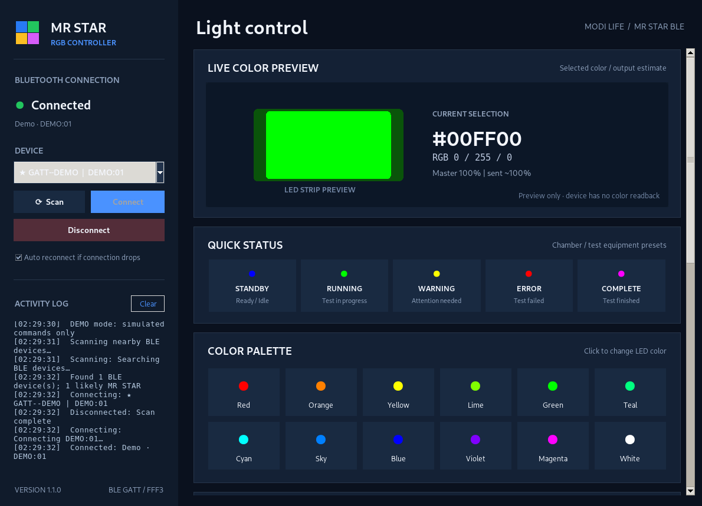
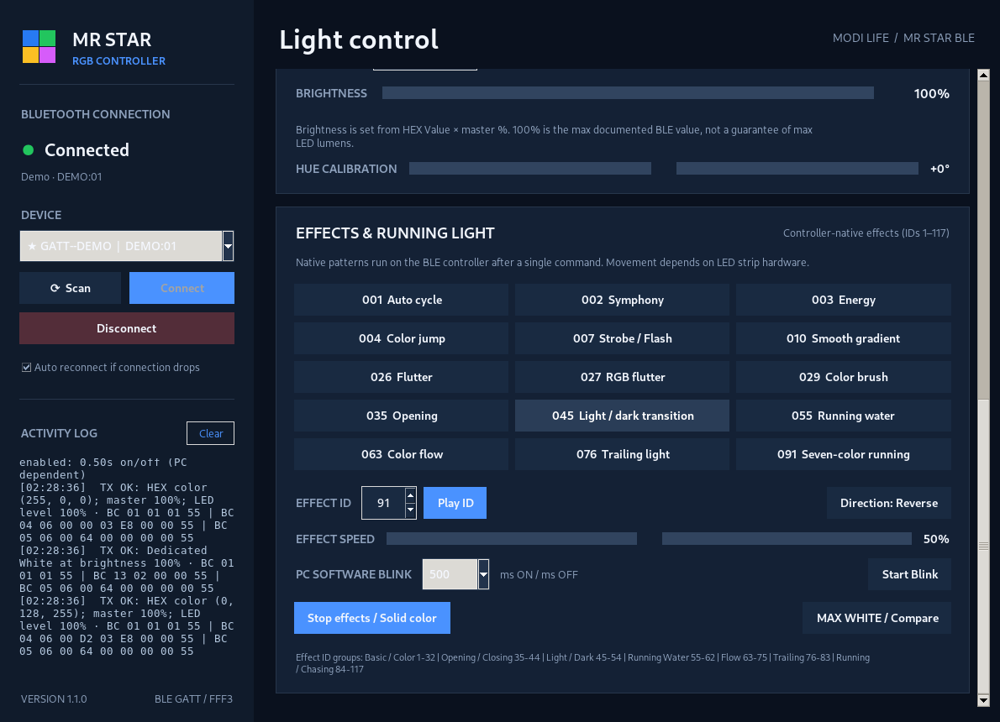

# MR STAR RGB Controller

### Bluetooth RGB Lighting Control for Windows
**Python GUI | Bluetooth Low Energy | RGB Colors | Brightness | Lighting Effects**

**[Features](#-key-features) · [Screenshots](#-screenshots) · [Installation](#-installation) · [Usage](#-how-to-use) · [Credits](#-credits--references)**

[English](README.md) | [ภาษาไทย](README_TH.md)

---

## 📋 Overview

**MR STAR RGB Controller** is a Windows desktop application for controlling compatible RGB LED lights over **Bluetooth Low Energy (BLE)**, without using the MR STAR mobile application or an infrared remote.

The project was developed and tested with a **MODI LIFE MD-NEON-U5 ECO RGB** light whose Bluetooth device advertises as **`GATT--DEMO`**. Other MR STAR / GATT-DEMO compatible lights may work, but behavior depends on their controller firmware and LED hardware.

The app provides a visual control panel for colors, brightness, lighting effects, and connection management. It can also serve as a starting point for **non-safety-critical machine, chamber, or test-equipment status indication**.

> **Connection note:** The LED's USB cable supplies power. The Windows application sends control commands through **Bluetooth LE**, not through USB data.

## ✨ Key Features

| Feature | Description |
|---|---|
| 🔵 BLE connection | Scan for compatible devices, connect/disconnect, and display connection status |
| 🔄 Auto reconnect | Attempt to restore the BLE connection when it drops |
| 🎨 RGB color control | Standard color palette, test-status presets, custom HEX input, and color picker |
| 💡 Brightness | Adjustable 0–100% GUI control with BLE brightness scaling |
| 🎯 Hue calibration | Adjustable hue offset to compensate for observed LED color differences |
| 🛠️ RGB compatibility fix | Optional workaround for Red/Green/Blue dimming at 99–100% on the tested controller |
| 🌈 Native lighting effects | 15 quick presets and manual selection of effect IDs 1–117 |
| ⚡ Effect controls | Adjustable speed and forward/reverse direction |
| 🚨 Software blink | Blink the selected color from the PC with selectable ON/OFF intervals |
| ⚪ White comparison | Dedicated MAX WHITE / Compare command for experimentation |
| 📝 Activity log | View connection events, command activity, and applied brightness information |
| 🧪 Demo mode | Open and explore the GUI without a physical BLE device |

## 🖥️ Screenshots

### Main control panel

  

### Effects and running lights

  

*Screenshots show the GUI in demonstration mode. Actual lighting effects depend on the connected controller and LED strip.*

## 🔌 Supported Hardware & Communication

| Item | Details |
|---|---|
| Tested light | MODI LIFE MD-NEON-U5 ECO RGB |
| Companion mobile app | MR STAR |
| BLE advertising name | `GATT--DEMO` (other firmware may use `GATT-DEMO`) |
| Transport | Bluetooth Low Energy (BLE) |
| GATT service | `0000FFF0-0000-1000-8000-00805F9B34FB` |
| Command characteristic | `0000FFF3-0000-1000-8000-00805F9B34FB` |
| Command framing | `BC <command> <length> <data...> 55` |
| Python BLE library | [Bleak](https://bleak.readthedocs.io/) |

The controller's commands are based on community reverse engineering of the MR STAR GATT protocol. The color command uses **HSV values**, while the GUI accepts familiar RGB / HEX colors. The application has no confirmed hardware color readback.

## 🚀 Installation

### Requirements

- Windows 10 or Windows 11 with a Bluetooth LE-capable adapter.
- Python **3.10 or newer** (with the Windows Python launcher, `py`).
- A compatible MR STAR / GATT-DEMO RGB controller and its required power supply.
- Internet access for first-time dependency installation.

### Option A — Windows batch files (recommended)

**1. Clone or download this repository.**

~~~powershell
git clone https://github.com/TOPTUBBY/Python-MR_STAR_RGB_Controller.git
cd Python-MR_STAR_RGB_Controller
~~~

**2. Run the installer.**

Double-click **`INSTALL_WINDOWS.bat`**. It creates a local Python virtual environment and installs the requirements.

**3. Launch the application.**

Double-click **`RUN_WINDOWS.bat`**.

### Option B — Run manually from PowerShell

~~~powershell
py -m venv .venv
.\.venv\Scripts\python.exe -m pip install -r requirements.txt
.\.venv\Scripts\python.exe app.py
~~~

The main BLE dependency is `bleak>=0.22,<4`, as listed in [requirements.txt](requirements.txt). The GUI uses Tkinter from the standard Python distribution.

### Build a Windows executable

Run **`BUILD_EXE.bat`** after installation. It installs PyInstaller as needed and builds:

~~~text
dist/MR_STAR_RGB_Controller.exe
~~~

Build the executable on a Windows PC. The source repository is not a guarantee that a prebuilt Windows executable is available.

## 🎮 How to Use

1. Power the RGB LED using the appropriate USB power source.
2. Disconnect the light from the **MR STAR mobile app** so it is available to your PC.
3. Enable Bluetooth on Windows and launch the controller.
4. Click **Scan**, select the `GATT--DEMO` device, and click **Connect**.
5. Use **Status Presets**, the **Color Palette**, or a custom **HEX** value to select a color.
6. Adjust **Brightness** or the optional **Hue Calibration** control.
7. Open **Effects & Running Light** to choose a preset or enter an effect ID (1–117). Adjust speed and direction where supported.
8. Use **Start Blink** for PC-controlled blinking, or **Stop effects / Solid color** to return to a steady color.
9. Use **Disconnect** when finished.

### Example machine-status colors

| Equipment status | Color | HEX |
|---|---|---|
| Standby / Idle | Blue | `#0000FF` |
| Running | Green | `#00FF00` |
| Warning | Yellow | `#FFFF00` |
| Error / Fail | Red | `#FF0000` |
| Completed | Magenta / Purple | User-configurable preset |

These status colors are application conventions, not a certified industrial alarm scheme.

### Experiment without a BLE device

~~~powershell
py app.py --demo
~~~

## 🌈 Lighting Effects

The interface includes **15 named effect presets**: Auto Cycle, Symphony, Energy, Color Jump, Strobe / Flash, Smooth Gradient, Flutter, RGB Flutter, Color Brush, Opening, Light/Dark Transition, Running Water, Color Flow, Trailing Light, and Seven-color Running.

An effect ID can also be entered manually from **1 to 117**. Available mode families and their names are derived from the reverse-engineered MR STAR protocol.

**Important:** Availability and appearance of each effect vary with controller firmware. True moving or chasing pixels require LED hardware capable of addressing separate LEDs or segments. A non-addressable RGB strip may illuminate the entire length together.

## 🔧 Brightness & Color Compatibility

### RGB primary-color dimming workaround — v1.1.2

During real-device testing, **pure Red, Green, and Blue** were unusually dim at GUI brightness **99% and 100%**, while **98%** appeared normally bright. Mixed colors were not affected.

The optional **RGB Primary Brightness Fix** is therefore **enabled by default**:

| Selected color | GUI setting | Applied BLE brightness |
|---|---:|---:|
| Pure Red / Green / Blue | 99–100% | 98% (raw `1003`) |
| Pure Red / Green / Blue | Up to 98% | Normal mapping |
| Yellow / Cyan / Magenta / other mixed colors | Up to 100% | Normal mapping (100% = raw `1024`) |

This is an **empirical compatibility workaround** for the tested unit, not a confirmed explanation of its firmware behavior. Disable the checkbox to compare the original commands.

### Other color notes

- Standard presets use values such as Red `#FF0000`, Green `#00FF00`, and Blue `#0000FF`.
- A custom HEX color is converted to HSV plus a separate brightness setting. Perceived LED color is not guaranteed to match an sRGB display.
- The `MAX WHITE / Compare` action uses a dedicated command whose behavior may differ across controllers.
- The activity log records requested/sent commands; it **does not verify the physical light output**.

## 📁 Project Structure

~~~text
Python-MR_STAR_RGB_Controller/
├── app.py                     # Windows Tkinter GUI
├── ble_manager.py             # BLE discovery, connection and background commands
├── protocol.py                # MR STAR BLE frames, HSV and brightness conversion
├── requirements.txt           # Python dependencies
├── INSTALL_WINDOWS.bat        # First-time environment setup
├── RUN_WINDOWS.bat            # Launch the GUI
├── BUILD_EXE.bat              # Build an executable with PyInstaller
├── assets/                    # Application icon and graphics
├── GUI_Preview_TOP.png        # Main GUI screenshot
├── GUI_Preview_EFFECTS.png    # Effects GUI screenshot
├── README_TH.md               # Detailed Thai documentation
├── RELEASE_NOTES_v1.1.2.txt   # Latest release notes
├── LICENSE                    # Project MIT License
└── README.md                  # This document
~~~

## 🐛 Troubleshooting

| Issue | Suggested action |
|---|---|
| Device not found | Power the LED, enable PC Bluetooth LE, close/disconnect the MR STAR phone app, and scan again |
| Connection drops | Move the PC closer, reduce interference, and try Auto Reconnect |
| LED does not change color | Confirm the GUI shows Connected; check the controller's GATT/firmware compatibility |
| Red/Green/Blue become dim at 99–100% | Enable **RGB Primary Brightness Fix** (default in v1.1.2) |
| Colors do not look exact | Check custom HEX, reset Hue Calibration to 0°, and compare at the same brightness |
| Effect does not appear to run | Try another ID; confirm whether the strip has individually addressable pixels |
| LED is dim or unstable | Verify the 5V USB supply and current capability against the lamp's specifications |
| Windows executable build fails | Run `INSTALL_WINDOWS.bat` first and review the output from `BUILD_EXE.bat` |

## 📊 Version History

| Version | Date | Changes |
|---|---|---|
| **v1.1.2** | 2026-10-30 | Primary RGB brightness workaround for the observed 99–100% dimming issue; on/off compatibility checkbox and activity-log visibility |
| **v1.1.1** | 2026-10-30 | Corrected GUI brightness mapping to BLE raw 0–1024; improved brightness diagnostics |
| **v1.1.0** | 2026-10-30 | Standard RGB/HEX presets, hue calibration, native effect presets, speed/direction, MAX WHITE comparison, and software blink |
| **v1.0.0** | 2026-10-30 | Initial Windows BLE GUI with scan/connect, basic color selection, brightness and status controls |

For implementation notes, see [README_TH.md](README_TH.md) and [Release Notes](RELEASE_NOTES_v1.1.2.txt).

## 🙏 Credits & References

This project benefited from the work of open-source developers who investigated the undocumented **MR STAR / GATT-DEMO Bluetooth LED protocol**.

### Primary protocol research

**[labsensacional / mrstar-ble-light](https://github.com/labsensacional/mrstar-ble-light)** — by **Mathias Gatti**.

- Reverse-engineered the MR STAR Android app and GATT command format.
- Documented the BLE service/characteristic, HSV color commands, power control, and native effect IDs.
- Provided a Python reference implementation that informed this project's BLE control design.
- Repository: https://github.com/labsensacional/mrstar-ble-light
- Detailed protocol analysis: [BLE Reverse Engineering](https://github.com/labsensacional/mrstar-ble-light/blob/main/docs/ble_reverse_engineering.md)
- Upstream license: [MIT License](https://github.com/labsensacional/mrstar-ble-light/blob/main/LICENSE) — © 2026 Mathias Gatti.

### Additional references

- **[mishamyrt / mr-star-ble](https://github.com/mishamyrt/mr-star-ble)** — community MR STAR Python implementation; referenced for the brightness conversion `int(1024 * brightness)`.
- **[Bleak](https://github.com/hbldh/bleak)** — cross-platform Python Bluetooth Low Energy library used by the application.

Thank you to the upstream maintainers for sharing their research and code. This is an **independent community GUI project** and is **not officially affiliated with MR STAR, MODI LIFE, or the upstream projects**.

## ⚖️ License & Safety

This repository is licensed under the **MIT License**. See [LICENSE](LICENSE). Upstream third-party work remains subject to its own license and required attribution.

**Safety notice:** This is a general-purpose Bluetooth lighting controller. Do **not** rely on it as the sole safety warning, emergency-stop indicator, hardware interlock, or other safety-critical signaling device for a chamber or test system. PC/Bluetooth disconnects can interrupt software-controlled blinking.

## 🤝 Support & Contributions

If you find a bug, a firmware-specific difference, or an additional supported effect, please [open an issue](https://github.com/TOPTUBBY/Python-MR_STAR_RGB_Controller/issues). Contributions are welcome via [pull requests](https://github.com/TOPTUBBY/Python-MR_STAR_RGB_Controller/pulls).

---

**Developed by [TOPTUBBY](https://github.com/TOPTUBBY)**

*MR STAR RGB Controller · v1.1.2 · Updated October 30, 2026*

